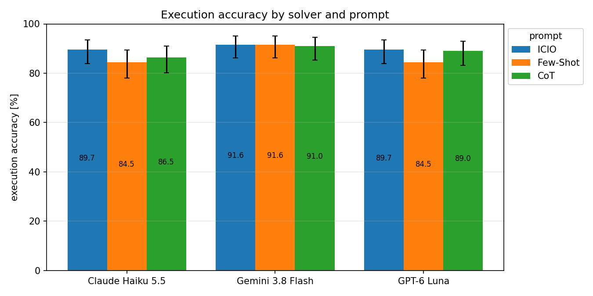
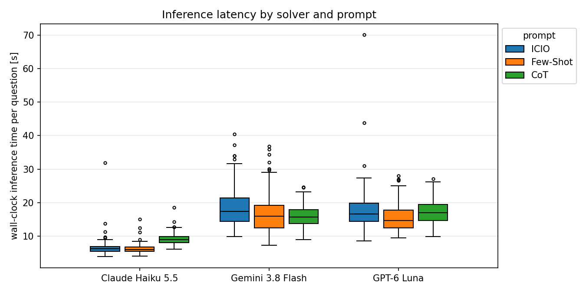

# Task 2: Text-to-SQL with three prompts



Execution accuracy on 155 questions, with median inference time per question:

| Solver | ICIO | Few-shot | CoT |
| --- | ---: | ---: | ---: |
| Claude Haiku 5.5 | **89.7%** · 6.2 s | 84.5% · 6.0 s | 86.5% · 8.9 s |
| Gemini 3.8 Flash | **91.6%** · 17.4 s | **91.6%** · 16.0 s | 91.0% · 15.7 s |
| GPT-6 Luna | **89.7%** · 16.7 s | 84.5% · 14.7 s | 89.0% · 16.9 s |

* **ICIO is best or tied for best for all three solvers.** Few-shot is the weakest for Claude and GPT (84.5%).
* **Gemini barely cares about the prompt:** 91.0–91.6% with every prompt.
* **The gaps are small:** at most 5.2 points, and all 95% CIs overlap. Task 4 tests them properly.

## Setup

* 155 questions from `data/restaurants_dataset.csv`, scored by execution accuracy with the course evaluator (`load_database`, `row_multiset`).
* 3 prompts from Task 1 ([`../Task_1/prompts/`](../Task_1/prompts/)) × 3 solvers = 1,395 predictions.
* Solvers are interactive coding agents (Lecture 2): Claude Code, Codex and Antigravity CLI, low reasoning effort. Here they are driven as "LLM as an API" (Lecture 3): a program builds the prompt and reads the SQL back. Every question gets a fresh session in an empty temp directory.
* Inference time = wall clock of the whole CLI call, start-up included. 3–7 calls ran in parallel.

## Latency



The solver sets the speed: Claude is 1.8–2.8× faster under the same prompt. CoT adds about 3 s for Claude only.

## Validity

* **Tool-use audit** of every session log ([tool_audit.csv](outputs/eval/tool_audit.csv)): Claude 0 of 472, GPT 0 of 474, Gemini 2 of 479 sessions used tools. Both Gemini sessions (Few-shot q85, q94) searched the web for the benchmark; q94 also ran `find` for database files. Agentic AI needs guardrails (Lecture 2): we invalidated both answers and re-ran them with all tools blocked by a deny-all hook.
* **Shared conventions:** column order, "rating above X" → `RATING > X` and ties for "best" come from the label format. All three prompts use them, and no gold rows appear in any prompt.
* **Ceiling below 100%:** 11 questions are solved by no combination, mostly due to label noise (122 are solved by all 9). E.g. q65 "What is the lifes greates illusion?" expects 2,696 rows. No solver got it, and no answers were hard-coded.

## Why (details in [Task 4](../Task_4/REPORT.md))

* Few-shot errors are wrong filter literals, not wrong query shapes. Models imitate the clean literals of the examples, e.g. q13 `'w evelyn ave'` instead of `'w evelyn ave ste 108'`. This is the "sensitive to choice of examples" weakness of few-shot prompting (Lecture 3).
* CoT costs time without a gain: the task is mostly mapping filters onto columns.

## Outputs

* [Predictions](outputs/predictions/): `<solver>__<prompt>.csv` in the course evaluator format.
* [Raw JSONL](outputs/raw/): every call with solver, model, effort, prompt id, raw output, SQL and latency.
* [summary.csv](outputs/eval/summary.csv) (mean/median/p90 latency, CIs in the figure) and [per_question.csv](outputs/eval/per_question.csv).

## Reproduce

`run` needs the `claude`, `agy` and `codex` CLIs installed (latest versions, see README for the exact ones) and logged in; `evaluate` needs nothing but the committed outputs.

```bash
cd Task_2/src
uv sync --project ..   # once
uv run --project .. python -m harness run        # all solvers x prompts, resumable
uv run --project .. python -m harness audit      # tool-use check, invalidates tainted records
uv run --project .. python -m harness run        # re-runs invalidated records
uv run --project .. python -m harness evaluate   # outputs/eval/*.csv and outputs/figures/*.png
```