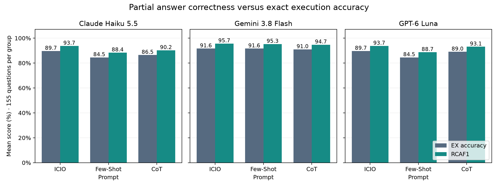

# Task 3: Row-Coherent Answer F1 (RCAF1)

**Idea:** give partial credit for returned rows that match the gold result, instead of EX's all-or-nothing 0/1.

$$
s(p,g)=\frac{2\,c(p,g)}{|p|+|g|},\qquad
W=\max_{M\ \text{one-to-one}}\sum_{(p,g)\in M}s(p,g),\qquad
\mathrm{RCAF1}=\frac{2W}{n+m}
$$

- $c(p,g)$ = equal cells at the same column position in predicted row $p$ and gold row $g$.
- $W$ = best one-to-one row pairing (exact maximum-weight assignment); $n$, $m$ = predicted and gold row counts.
- RCAF1 is the harmonic mean of soft precision $W/n$ and soft recall $W/m$. Range [0, 1].
- Same cell equality as Task 2's EX (no rounding, no string normalization). SQL errors or no extractable SQL → 0.

## Worked example: q22

The query asks for Alameda restaurants with rating > 2. All nine solver × prompt runs return the same answer.

| | Gold | Predicted |
|---|---:|---:|
| Rows | 62 | 63 (all 62 gold + 1 extra) |
| EX | – | **0** |
| RCAF1 | – | $2\cdot62/(63+62)$ = **0.992** |

EX treats this the same as a completely wrong query. RCAF1 shows it is one row off.

## Why it's a good metric

- Separates near misses from total misses, where EX gives both 0.
- Keeps rows coherent: cells only match inside paired rows and the same column, so scattered matching values earn nothing.
- Scores the returned answer, not the SQL text. Different correct formulations score the same, with no LLM judge.
- Penalises both missing and extra rows, and duplicate counts are preserved.

## Complements, not replaces

- EX stays the success criterion. A 0.99 answer can still contain one consequential wrong row.
- RCAF1 measures *how wrong* a failed answer is. It is a check against false negatives from a binary verdict (Lecture 1).
- Every EX-correct prediction scores RCAF1 = 1 (1,237/1,237), so the two never disagree on successes.

## Results



| RCAF1 (%) | ICIO | Few-Shot | CoT |
|---|---:|---:|---:|
| Claude Haiku 5.5 | **93.7** | 88.4 | 90.2 |
| Gemini 3.8 Flash | **95.7** | 95.3 | 94.7 |
| GPT-6 Luna | **93.7** | 88.7 | 93.1 |

- **ICIO is best for every solver** under RCAF1, matching the EX ranking.
- **Partial credit adds only 3.7–4.2 pp** per combination. Of 158 EX-wrong predictions, 74 get partial credit; 84 score 0.
- **The prompt ranking does not change.** Significance tests are in [Task 4](../Task_4/REPORT.md).

155 questions per group, 1,395 predictions, no evaluation failures. Full data: [per question](outputs/metric_per_question.csv), [summary](outputs/metric_summary.csv), [baseline check](outputs/baseline_crosscheck.txt).

## Limitations

- **Agreement with gold rows, not with intent.** q22 and q120 fail EX for all nine runs by one extra row; this may be a label issue, which RCAF1 cannot tell apart.
- **Exact cell equality.** `1` equals `1.0` but not `"1"`; approximate numbers and equivalent strings get no credit. Row order and column names are ignored.
- **A mean hides which questions fail.** Use the per-question CSV for that.

## Reproduce

Implementation: [`src/metric.py`](src/metric.py); pipeline: [`src/evaluate.py`](src/evaluate.py). From `Week_03_Prompting/Assignments`:

```sh
uv sync --project Task_3 --group dev
uv run --project Task_3 python Task_3/src/evaluate.py
```
