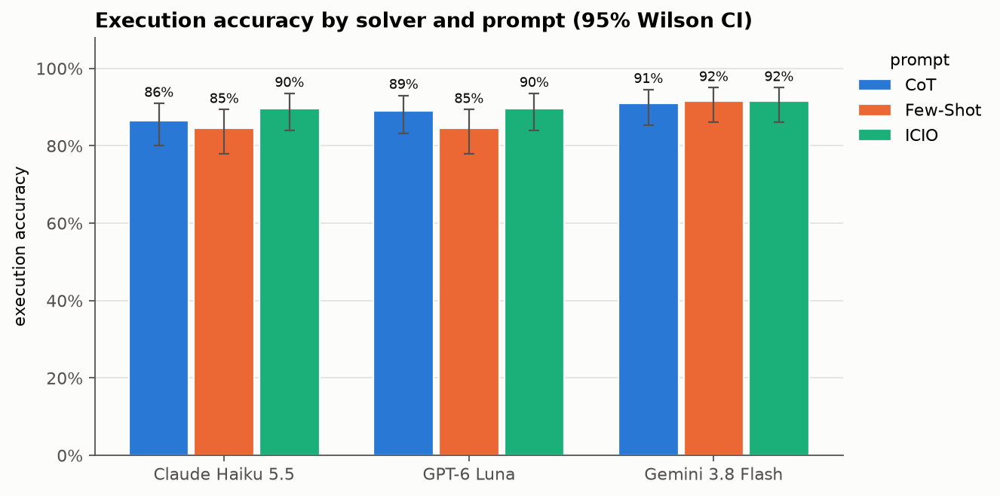
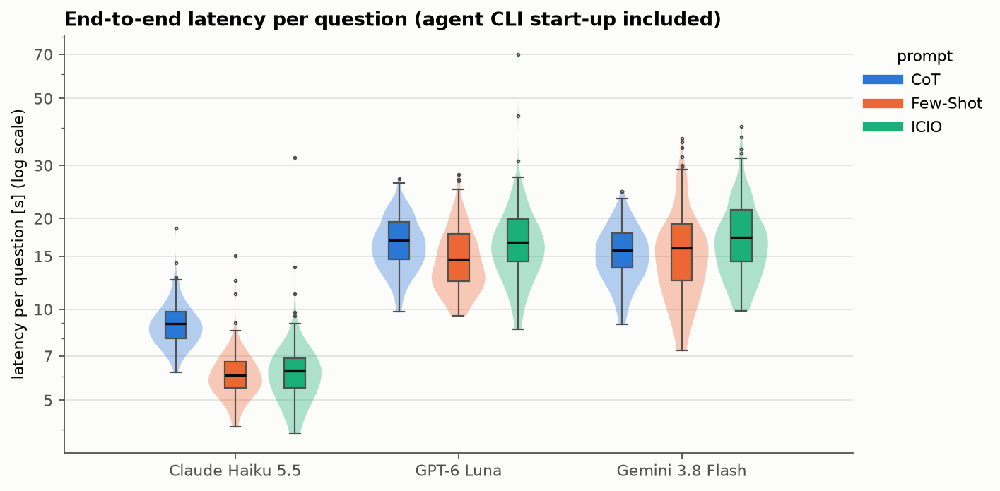
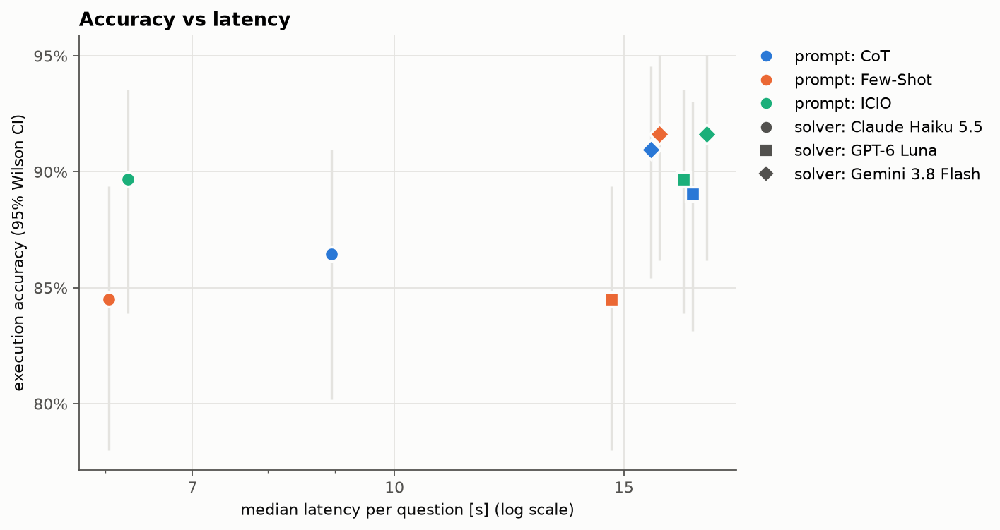

# Task 4: Prompts, models and coding agents compared

**Only ICIO vs Few-Shot is significant: +3.4 pp, Holm p = 0.007.** CoT sits in between and differs from neither. **Gemini 3.8 Flash ignores the prompt: 91.0–91.6%, p = 0.82.** Claude Haiku 5.5 and GPT-6 Luna both drop 5.2 pp with Few-Shot. **Latency is the solver, not the prompt: partial η² 0.77 vs 0.08.**

Data: 155 questions × 3 prompts × 3 solvers = 1,395 predictions from [Task 2](../Task_2/REPORT.md). Metrics: execution accuracy (EX), RCAF1 from [Task 3](../Task_3/REPORT.md), wall-clock latency per call.

## Accuracy



| Solver (model + CLI) | ICIO | Few-Shot | CoT | Median latency |
| --- | ---: | ---: | ---: | ---: |
| Claude Haiku 5.5 + Claude Code | 89.7% | 84.5% | 86.5% | 6.0–8.9 s |
| GPT-6 Luna + Codex CLI | 89.7% | 84.5% | 89.0% | 14.7–16.9 s |
| Gemini 3.8 Flash + Antigravity | **91.6%** | **91.6%** | 91.0% | 15.7–17.4 s |
| Pooled | **90.3%** | 86.9% | 88.8% | 12.4–14.4 s |

* All 95% CIs overlap ([summary_by_config.csv](outputs/tables/summary_by_config.csv)). Only paired tests see the difference.
* 122 of 155 questions are solved by all 9 configurations, 11 by none. The comparison rests on 22 contested questions ([correctness_heatmap.png](outputs/figures/correctness_heatmap.png)).

## Is it significant?

Every configuration answers the same 155 questions, so all tests are paired. Cochran's Q → exact McNemar for EX; Friedman → Wilcoxon for RCAF1 and latency. Pairwise p-values are Holm-corrected.

| Comparison | Difference | p (Holm) | Significant? |
| --- | --- | ---: | --- |
| Prompts overall, pooled (Cochran's Q) | Q = 12.1 | 0.002¹ | yes |
| ICIO vs Few-Shot, pooled | +3.4 pp (21 vs 5) | 0.007 | **yes** |
| ICIO vs CoT / CoT vs Few-Shot, pooled | +1.5 / +1.9 pp | 0.186 | no |
| ICIO vs Few-Shot, Claude Haiku 5.5 | +5.2 pp (9 vs 1) | 0.064 | no |
| ICIO vs Few-Shot, GPT-6 Luna | +5.2 pp (10 vs 2) | 0.116 | no |
| Prompts within Gemini 3.8 Flash (Cochran's Q) | Q = 0.4 | 0.82¹ | no |
| Gemini vs Claude, and Gemini vs GPT, on Few-Shot | +7.1 pp (11 vs 0) | 0.003 | **yes** |
| GEE terms: prompt / solver / prompt × solver | Wald χ² 6.6/7.3/8.4 | 0.037 / 0.026 / 0.079¹ | yes / yes / no |

¹ Raw p of a single test. "21 vs 5" = discordant solver × question pairs won by each side.

* **Pairing is essential.** A logistic regression that ignores the question finds nothing (prompt p = 0.25). The GEE clustered on question recovers the effect.
* Full tables: [pairwise pooled](outputs/tables/pairwise_prompts_pooled.csv), [pairwise within solver](outputs/tables/pairwise_prompts_within_solver.csv), [solvers within prompt](outputs/tables/pairwise_solvers_within_prompt.csv), [GEE terms](outputs/tables/gee_logistic_terms.csv).

## Latency



The solver sets the level (\~6 s Claude vs 15–17 s others). Only CoT on Claude Haiku 5.5 moves it: +2.8 s median paired difference, r = 0.94 ([latency_anova.csv](outputs/tables/latency_anova.csv)).



**RCAF1** gives the same ranking and the same verdict (ICIO vs Few-Shot, Holm p = 0.003): [metric_rcaf1.png](outputs/figures/metric_rcaf1.png).

## Why

### Prompt

* **Few-shot prompting is sensitive to the choice of examples** (Lecture 3). Ours use clean literals, e.g. "the monterey region" → `REGION = 'monterey'`. Models copy that style and normalise literals:
  * q13, Claude + Few-Shot: `STREET_NAME = 'w evelyn ave'` (wrong). Claude + ICIO: `'w evelyn ave ste 108'` (right).
  * q94, Claude + Few-Shot: `REGION = 'yosemite and mono lake'` (wrong; the value ends in `area`).
  * q85, GPT + Few-Shot: `CITY_NAME = 'los angeles'` (should be the region `'los angeles area'`).
* **Few-Shot has incomplete context.** It names 4 regions; ICIO and CoT list all 9. "Context is king": complete, correct, well presented (Lecture 3). Missing information → hallucinated literals.
* **ICIO's explicit rule works.** "Using the lowercase value exactly as written" fixes these literals. Side effect: it sometimes copies extra words (q63 `FOOD_TYPE = 'dessert food'`).
* **CoT adds length, not accuracy.** Outputs are 4.4–6.7× longer than ICIO by median characters ([raw_output_diagnostics.csv](outputs/tables/raw_output_diagnostics.csv)). The task is mostly mapping phrases to columns, so there is little to reason about.

### Model

* **Gemini 3.8 Flash keeps literals verbatim under every prompt.** The prompt style barely reaches it (Q = 0.4).
* **Claude Haiku 5.5 and GPT-6 Luna are steerable both ways.** They follow examples as readily as rules → identical 84.5% ↔ 89.7% swings.
* **Errors are literal fidelity, not SQL skill.** No prediction failed to execute. The contested errors are wrong filter values.

### Coding agent

* All three solvers are interactive coding agent CLIs: Claude Code CLI, Codex CLI, Antigravity CLI. Here each runs headless, one fresh session per question.
* **Fixed per-call overhead dominates latency.** For \~180-character answers Claude Code needs \~6 s, the others 15–17 s. CoT's extra tokens only show where that overhead is small (Claude).
* **The agent's own context is noise for this task.** Each CLI injects its system prompt and the global instruction file. "Keep your context clean" (Lecture 3). It did not break the format: 0 code fences, 0 empty SQL in 1,395 outputs.
* **Agents act on their own.** Antigravity's `--read-only` still let Gemini search the web in 2 sessions; those were re-run with tools blocked (Task 2). Agentic AI carries operational risk and needs strict guardrails (Lecture 2).
* **Model and CLI are confounded.** Each solver is one model in one CLI, so "solver" effects cannot be split into model vs agent.

## What this shows / What this does not show

**What this shows**

* → **Prompt content beats prompt framework.** The one significant gap tracks what the prompt tells the model, not its structure.
* → **The prompt effect depends on the solver.** Gemini is flat; Claude and GPT lose 5.2 pp with Few-Shot.
* → **Latency is a solver property.** Partial η² 0.77 for solver vs 0.08 for prompt.
* → **Paired analysis is required.** Unpaired CIs and an unclustered regression miss a real +3.4 pp effect.

**What this does not show**

* → **Not a clean framework comparison.** Few-Shot lacks the full region list and the "exactly as written" rule.
* → **Not model vs agent.** The two are confounded in every solver.
* → **Low power.** Only 22 contested questions; per-solver tests do not survive Holm.
* → **Latency is not clean.** Configurations ran in different time windows with 3–7 parallel calls; \~1 s prompt differences are within load drift.

## Reproduce

```bash
uv sync && uv run task4-analysis run      # writes outputs/tables and outputs/figures
uv run ruff check src && uv run pyright
```