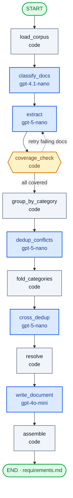

# Requirements-refinement network

The network reads a directory of source documents and writes one Markdown requirements document. It is a LangGraph `StateGraph`. The only CLI arguments are the input directory and `-o` for the output path. File names are not hard-coded; every `.txt`, `.eml`, and `.md` file under the directory is a source, and its id is the relative path.

Model ids live in `requirements_network/models.py` and nowhere else:

| Role | Model | Why this one |
| --- | --- | --- |
| Classify each document | `gpt-4.1-nano` | Genre and a date are a small decision. The cheapest model that is not also doing extraction. The prompt classifies by form: an email thread stays an email when it summarises requirements, and meeting notes stay a decision when they also list requirements. |
| Extract requirements, judge duplicates within a category, and judge duplicates across categories | `gpt-5-nano` | The steps that have to read carefully. The cross-category pass sends only id, short name, and category, so it stays one cheap call. `reasoning_effort` is `low` so the model still reasons, without a high reasoning bill. Temperature is left unset because this model rejects any other value. |
| Polish names, paragraphs, and blacklist explanations | `gpt-4o-mini` | Wording only. A different family from the two nanos, which is the third required model. Temperature 0. |

No other model id is called. If the API rejects one of these three, the run stops.

## Graph

Blue nodes call a model, grey nodes are plain code, and the amber node is the deterministic check that drives the feedback loop (dotted arrow).

## Why each node is code or a model

| Node | Kind | What it is for |
| --- | --- | --- |
| `load_corpus` | code | Discover files and keep the relative path as the document id. A model must not invent the corpus. |
| `classify_docs` | `gpt-4.1-nano` | Label `doc_type`, an ISO date or null, and a one-line summary. The type is the document's form, which is what conflict resolution later trusts. The prompt says an email thread stays an email. Code still forces that when the head has `From:` and `Subject:` lines, because the model sometimes labels the thread by its topic. Long documents are classified from the head and the tail. |
| `extract` | `gpt-5-nano` | Per document, in a pool of four calls: raw requirements, or a non-empty reason that the file states none. A document longer than 12 000 characters is split on a line boundary with a short overlap, so one answer is not truncated and a requirement on the cut still appears whole in one piece. |
| `coverage_check` | code | Every document must be cited by at least one requirement, or carry a real "no requirements" reason, and every cited source must exist in the corpus. This is a check, not a judgement call. |
| `group_by_category` | code | Bucket requirements and assign temporary ids. The model must not be the thing that invents ids. |
| `dedup_conflicts` | `gpt-5-nano` | Per category, with the full text. It hunts paraphrases: if building one item would already satisfy the other, they are the same requirement. Different numbers, actors, triggers, or scope stay apart. It proposes merged wording. It does not edit source lists. |
| `fold_categories` | code | Apply that judgement. Sources are united, the stronger priority is kept, conflict losers and nonsense are blacklisted. The boost waits, because the next merge can still add sources. |
| `cross_dedup` | `gpt-5-nano` | The same model, a smaller question. It sees only the id, the short name, and the category of each survivor, and returns duplicate sets that crossed categories. The list is sorted by name and sent in overlapping windows of 80, because one flat list was skimmed and under-called. |
| `resolve` | code | Confirm those sets, then merge them the same way as within a category, then apply the one-level boost. A set that does not span two categories is ignored: the full-text pass already judged that pair, and a name-only second guess inside one category is weaker. Authority order is fixed: decision, specification, interview, email, survey, reference, other. Same rank, newer date wins. Same rank and same date is an open conflict: keep the longer text, and say so. |
| `write_document` | `gpt-4o-mini` | Final ids are assigned before this call, so a blacklist sentence can name `REQ-012` and the model is not shown a temporary id. One vocabulary (patron, item, hold, branch, staff), a paragraph per requirement, and a human blacklist explanation. |
| `assemble` | code | Write the ids assigned before polishing. Sorting again by the polished name would renumber them. Any temporary id still in the text is replaced with the final id, or with the requirement's name when the row was discarded. |

## Feedback loop

`coverage_check` is the loop. When a document fails, its id goes back to `extract` and the failure sentence is added to that call's prompt. Other documents are not extracted again. A document may be extracted once plus two retries. After that it is listed under "Uncovered documents" and the run continues with whatever text was extracted.

## How the assignment specs are covered

| Spec | Where it is handled |
| --- | --- |
| ANS1 at least three model nodes | `classify_docs`, `extract`, `dedup_conflicts`, `cross_dedup`, `write_document` |
| ANS2 at least one code node | `load_corpus`, `coverage_check`, `group_by_category`, `fold_categories`, `resolve`, `assemble` |
| ANS3 a feedback loop | `coverage_check` returns failing documents to `extract` |
| ANS4 three models | `gpt-4.1-nano`, `gpt-5-nano`, `gpt-4o-mini` |
| ANS5 LangGraph | `StateGraph` in `requirements_network/graph.py` |
| OS1 one document | `assemble` writes a single Markdown file |
| OS2 unique ids | `REQ-001` … assigned after resolution and before polishing, sorted by category then MoSCoW. Assemble does not renumber. |
| OS3 no semantic duplicates | `dedup_conflicts` hunts paraphrases inside a category; `cross_dedup` hunts the same obligation filed under two categories; `fold_categories` and `resolve` merge in code and union sources |
| OS4 tracing | every requirement has source paths; a requirement that cites nothing in the corpus is blacklisted |
| OS5 short name and a paragraph | extract drafts both; `write_document` rewrites them and is not allowed to drop the requirement |
| OS6 priority and a defined scale | MoSCoW on each requirement; the scale and the boost rule are in the document |
| OS7 consistent language, no contradictions | polish uses one vocabulary; conflicts are removed or recorded as open when authority and date tie |
| OS8 completeness | the extract prompt forbids skipping a stated obligation; coverage sends an uncited document back |
| OS9 blacklist | duplicates, conflict losers, and nonsensical items are a separate section with sources and a reason. The reason cites the surviving `REQ-xxx`, never the temporary id. |

## Resolution rules worth knowing

- Merged duplicates keep the union of sources and the stronger priority. The surviving id is the one the judge named, unless that id is not in the set. A cross-category merge does this too. The model for that pass never saw the paragraphs, so the code concatenates them and polish turns them back into one paragraph.
- A blacklist reason names the survivor as `[[KEPT]]` until final ids exist. Those ids are assigned before polishing, the mark is replaced with `REQ-xxx`, and the polish model is not given a temporary id. Assemble still scrubs one if it leaks.
- A requirement backed by a decision document, or by at least three distinct sources, is raised one MoSCoW level. Must stays Must. The boost runs once, after both merge passes, so a decision and three sources together do not raise it twice, and a source added by the cross-category merge still counts. An explicit Won't that meets either condition becomes a Could. That follows the boost rule as written; it can soften an exclusion that a meeting recorded on purpose.
- Conflict authority uses the strongest source type on the requirement, then the newest date among sources of that type. A missing date is older than any real date.
- A loser is removed only if the requirement that beats it is itself staying. A discarded winner does not take its opponent with it.

## Known limitations

- The cross-category pass sees short names, not paragraphs. It can merge two requirements that share a title but differ in a number or an exception, or miss a paraphrase whose names do not look alike. A same-category proposal from that pass is ignored on purpose.
- The cross pass is windowed at 80 names, sorted, with overlap. A single list of every survivor was skimmed and under-called. A paraphrase pair that is far apart alphabetically and falls in different windows can survive twice.
- Classification does not read the middle of a very long document, so a date that appears only there can be missed. Extraction still sees the whole text. A `From:` and `Subject:` in the first 8 000 characters force the type to email. A document with neither mail headers nor a meeting heading can still be mislabeled.
- Chunking can quote the same sentence twice when it falls in the overlap. The within-category pass is expected to collapse that. The cross pass collapses it only when the names still look like the same obligation.
- The judge can miss a contradiction or call two similar requirements duplicates. The code does not second-guess the judgement beyond id checks, source unions, and the authority order.
- Polish is allowed to rephrase, not to add facts. It can still smooth a detail away. A source mismatch throws the polish away for that requirement; a quiet wording change does not.
- Outputs are not deterministic. A second run can group, split, or rank differently.
- `gpt-5-nano` is run at low reasoning effort. A harder contradiction can be missed that a higher effort would have caught. Higher effort was not used because the point of this model choice is to keep the call cheap.
