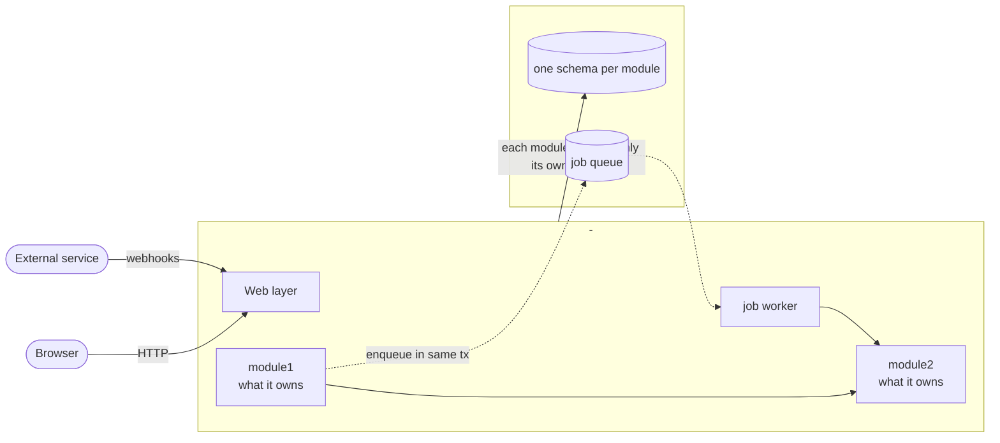
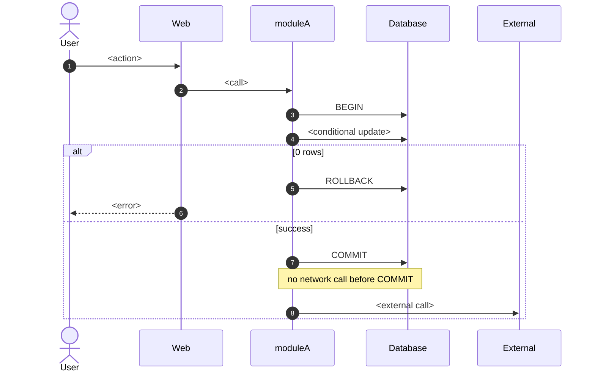

# ADR template

Follow this structure. Section order matters: a reader should be able to stop after the Summary, or after the diagrams, and still know the decision. Replace everything in `<...>`.

````markdown
# ADR-<NNN>: <the decision as a statement, e.g. "X is built as a modular monolith on one Postgres">

**Status:** Proposed | Accepted
**Date:** <YYYY-MM-DD>
**Deciders:** <names / team>

## Summary

- **<Architecture>:** <one line: shape, DB, workers, how it runs>.
- **<How the hardest problem is solved>:** <one line>.
- **<Second key rule>:** <one line>.
- **<Integrations that matter>:** <one line>.
- **Rejected:** <option B> (<why in a few words>) and <option C> (<why>).

## Context

<2-3 lines: what the system is, who uses it, link to the requirements file.>

<One line: whether the difficulty is in the domain or in scale.>

- **<Hard part 1>.** <why it is hard, in 1-2 lines>
- **<Hard part 2>.** ...

Constraints:

- <team, deadline, who writes code>
- <how it must run>
- <typing / validation / other non-functional needs>

## Decision

<1-2 sentences.>

- <3-5 bullets of the structural choices. No detail here; details live in Key Design Rules.>

The exact rules are in [Key Design Rules](#key-design-rules).

### Component diagram



<Legend, one or two lines: what solid vs dotted arrows mean, and which obvious arrows were left out.>

### <Hardest flow> sequence



<1-2 lines on anything the diagram cannot show, e.g. which job races with which step.>

## Options Considered

- **A. <Name> (chosen).** <1-2 sentences: shape.>
- **B. <Name>.** <1-2 sentences: shape, and how the hardest flow would work.>
- **C. <Name>.** <1-2 sentences.>

## Trade-off Analysis

| | A. <Name> | B. <Name> | C. <Name> |
|---|---|---|---|
| Deploy units | | | |
| <Hardest flow> | | | |
| Background work | | | |
| Where logic lives | | | |
| Validation / types | | | |
| Debugging | | | |
| Testing | | | |
| Time to first feature | | | |
| Main risk | | | |

- **A vs B:** <why B lost, in 2-3 lines>. Rejected.
- **A vs C:** <why C lost>. Rejected.
- **<Hybrid / middle way>:** <why it was rejected, or omit if none came up>.

## Key Design Rules

These follow from the decision and are part of it.

1. **<Rule as a short imperative>.** <How, with a code block if it is a query or signature.> <Why.>
2. **<Only one place may change state X>.** <function name, allowed moves, guard>.
3. **<No network calls inside a DB transaction>.** ...
4. **<Structural borders are enforced by the build>.** <tool, mechanism>.
5. **<All timeouts in one job>.** <list each timeout with its value and what happens>.

## Technology Stack

- **<Tool>** - <why, one sentence>.
- **<Tool>** - <why>.
- **<Run command>** - <what it starts>.

## Consequences

**Easier**
- <...>

**Harder**
- <...>

**Risks (where it bites first)**
1. <failure mode> → <effect>. Mitigated by rule <n>.
2. <...>

**To revisit**
- <only what truly cannot be decided now, with the trigger that would reopen it>
````

## Do not include

- Per-option assessment tables (complexity / cost / familiarity). They repeat the trade-off table and say little.
- Action items, implementation plan, task lists.
- The same mechanism described in two sections.
- Open spec questions that could have been decided in the discussion.
- En / em dashes.
