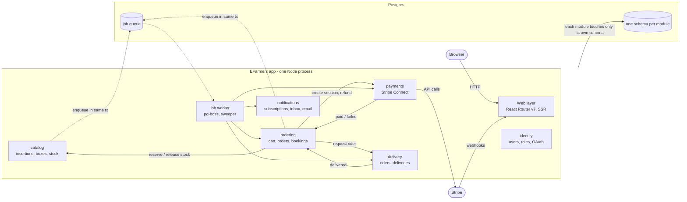
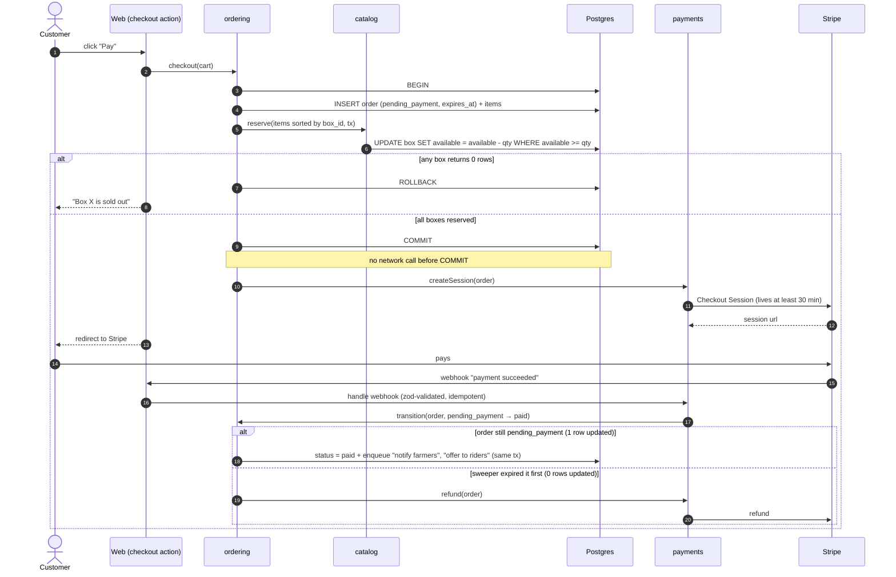

# ADR-001: EFarmers is built as a modular monolith on one Postgres

**Status:** Accepted
**Date:** 2026-10-28
**Deciders:** Vladko + project team (3 students)

## Summary

- **Modular monolith:** one TypeScript app (React Router v7, SSR), one Postgres, job worker inside the same process. Starts with `docker compose up`.
- **Races are solved by plain transactions:** a box is taken by one conditional `UPDATE` at checkout, not in the cart. A rider takes a delivery the same way.
- **Calendar bookings are paid only after the farmer accepts**, so a decline never needs a refund. A future harvest is just a box with an `available_from` date.
- **Payments:** Stripe Connect, one charge per order, one transfer per farmer.
- **Rejected:** microservices (sagas and polling for a 3-person team) and Supabase (logic spread over RLS, plpgsql and Edge Functions).

## Context

EFarmers is a marketplace connecting local farmers, customers and riders (see `Tasks/data/EFarmers.txt`, 36 user stories). One account can be customer, farmer and rider at the same time.

The domain, not the scale, makes it hard:

- **Box stock.** A farmer's insertion holds boxes (the product, e.g. "5 kg potatoes, 8 €, 20 pcs"). Boxes are few and perishable. Cart orders and calendar bookings compete for them. Two customers must never pay for the last box.
- **Order + payment lifecycle.** A cart can mix boxes from several farmers. One payment must be split to many farmers. Webhooks arrive late, farmers decline, riders may never show up, so refunds must happen.
- **Rider dispatch.** Two riders must not take the same delivery.
- **Background work.** New insertion → notify every subscriber, expire unpaid orders, offer deliveries to riders, pay out farmers, compute badges.

Constraints:

- Team of 3 students with a school deadline. Most code will be written by AI agents.
- Must start with one command (`docker compose up`). No zoo of processes.
- Strong typing and validated inputs, so that AI-written code is checked by tools, not by discipline.

## Decision

Build EFarmers as a **modular monolith**: one TypeScript application, one Postgres database, background worker running inside the same process.

- Modules: `identity`, `catalog`, `ordering`, `payments`, `delivery`, `notifications`. Each module owns its own Postgres schema.
- Every contested change (taking box stock, accepting a booking, a rider accepting a delivery) is **one conditional update inside one database transaction**.
- Background jobs use a **Postgres-backed queue** (pg-boss), written in the same transaction as the business change.
- Payments use **Stripe Connect** (separate charges and transfers).

The exact rules are in [Key Design Rules](#key-design-rules).

### Module diagram



The web layer calls every module, so those arrows are left out. Solid arrows are direct function calls between modules (they can share one transaction). Dotted arrows are jobs that may run a few seconds later.

### Checkout sequence



An accepted calendar booking joins this flow at "createSession" (see rule 7).

## Options Considered

- **A. Modular monolith (chosen).** One app, one Postgres, strict module borders, in-process job worker. See the diagrams above.
- **B. Microservices + events.** Services Identity, Catalog (owns stock), Ordering, Payments, Delivery, Notifications, each with its own DB. RabbitMQ broker, API gateway, outbox in each service. Checkout becomes a saga orchestrated by Ordering, with compensating events (`OrderExpired` → release stock, late payment → refund).
- **C. Backend-as-a-Service (Supabase).** Frontend talks to Postgres directly. CRUD via Row Level Security, checkout and booking as Postgres functions (`rpc`), Stripe in Edge Functions, jobs via pg_cron + pgmq, Realtime for notifications.

## Trade-off Analysis

|                       | A. Modular monolith                 | B. Microservices                           | C. Supabase                               |
| --------------------- | ----------------------------------- | ------------------------------------------ | ----------------------------------------- |
| Deploy units          | 1 process (web + worker)            | ~6 services + broker + gateway             | Supabase + Edge Functions + frontend      |
| Checkout / stock      | 1 transaction                       | saga + compensations, UI polls after "pay" | 1 transaction in a DB function            |
| Background work       | Postgres queue, same process        | broker + consumers                         | pg_cron + pgmq                            |
| Where logic lives     | one TS codebase                     | spread over services                       | RLS + plpgsql + Edge Functions + frontend |
| Validation / types    | zod everywhere, shared types        | per service + event contracts              | only DB constraints                       |
| Debugging             | one stack trace                     | distributed tracing                        | plpgsql, RLS fails silently (empty rows)  |
| Testing               | unit + integration on real Postgres | + contract tests                           | pgTAP + deno test + E2E                   |
| Time to first feature | medium                              | slow                                       | fastest (~50 % of stories are CRUD)       |
| Main risk             | module borders rot                  | plumbing eats the project                  | logic hard to follow, lock-in             |

- **A vs B:** B buys independent scaling and deploys that 3 students do not need. It pays with polling after "pay", idempotent handlers, outboxes and tracing. And the stock race stays local anyway (all boxes live in Catalog), so B does not solve the hardest part better. Rejected.
- **A vs C:** C saves the CRUD half of the work, but makes the hard half (checkout, booking, refunds) the hardest to debug and test. Rejected.
- **Middle way** (monolith + separate notification / dispatch services) was also rejected. The in-process worker already isolates slow work, and dispatch has the same race as stock, so it must stay next to orders.

## Key Design Rules

These follow from the decision and are part of it.

1. **Stock is reserved at checkout, not in the cart.** The cart is a wish list and only holds boxes that are already available. On "pay", one conditional update per box, sorted by `box_id` to avoid deadlocks:
   ```sql
   UPDATE catalog.box SET available = available - :qty
   WHERE id = :id AND available >= :qty
     AND available_from <= now() AND expires_at > now();
   ```
   0 rows → sold out → roll back. `CHECK (available >= 0)` as a safety net. A cart order waits in `pending_payment` for 30 min (the Stripe Checkout minimum).
2. **Order status changes only through `ordering.transition(orderId, from, to)`** with a fixed list of allowed moves and `WHERE status = :from`. When two actors race (e.g. webhook vs sweeper), only one wins; if the loser already took money, it refunds.
3. **No network calls inside a DB transaction.** Lock and commit first, then call Stripe.
4. **Module borders are enforced by the build.** dependency-cruiser fails CI on imports of another module's internals. Table objects are not exported from their module, so other modules cannot query them.
5. **Payments:** one charge per order, one Stripe `Transfer` per farmer (`transfer_group = order_id`). We compute the shares and decide when to transfer (after delivery).
6. **A future harvest is just a box with `available_from`.** E.g. the farmer creates "strawberries, 1 kg, 50 pcs, from 1 June" today. There is no separate pre-order concept. Future boxes can only be booked from the calendar, not put in the cart.
7. **Calendar booking: pay only after the farmer accepts.** A booking request (`requested`) takes no stock and no money. When the farmer accepts, stock is taken with the rule 1 update (without the `available_from` condition) and an order is created in `pending_payment`, which then follows the normal checkout flow. If the stock is already gone, the accept fails and the booking is declined. The customer gets a notification with the payment link and has **24 h** to pay, like a reservation.
   - Why: paying upfront would mean a refund for every decline.
   - Booking states: `requested → accepted | declined`. An accepted booking points to its order.
8. **Rider dispatch: offer to all available riders, first to accept wins.** When a paid home-delivery order is ready (right away for cart orders, on `available_from` for future boxes), a job notifies all riders with status `available`. Accepting is one conditional update:
   ```sql
   UPDATE delivery.delivery SET rider_id = :rider, status = 'assigned'
   WHERE id = :id AND status = 'open';
   ```
   0 rows → someone was faster → the rider sees "already taken".
9. **One sweeper job** (pg-boss, every minute) handles all timeouts:
   - order `pending_payment` past its `expires_at` (30 min cart, 24 h booking) → `expired`, stock goes back;
   - delivery still `open` 2 h after it was offered → the customer is told no rider is available and chooses: pick it up at the farmer, or cancel and get a refund.

## Technology Stack

- **TypeScript (strict)** - strong types shared between server and UI, and the language AI writes best. Rust was rejected as too slow to develop in.
- **React Router v7, server-rendered** - SEO for public pages, and typed loaders / actions instead of a separate API.
- **Drizzle + Postgres** - typed queries and one schema per module.
- **zod on every input** - forms, webhooks and env are validated at the edge.
- **pg-boss in the app process** - jobs without Redis, enqueued in the same transaction.
- **Better Auth** - email and OAuth registration (US 1, 29).
- **Stripe Connect** - Stripe handles farmer KYC and payouts.
- **`docker compose up`** - app + Postgres with one command.

## Consequences

**Easier**

- Correct stock, booking and dispatch handling: plain transactions instead of sagas.
- Reading and debugging a whole flow in one codebase.
- Local development and testing against a real Postgres.

**Harder**

- Keeping module borders clean (needs CI rules from day one).
- Heavy jobs share the event loop with web requests.
- Scaling one part independently.

**Risks (where it bites first)**

1. Order status written from many places (checkout, webhook, sweeper, booking accept, rider, refunds) → double refunds, lost stock. Mitigated by rule 2 and by putting our few deep tests on the state machine.
2. Stripe call inside a transaction holding box locks → other buyers wait. Mitigated by rule 3.
3. Big fan-out job slows pages. Mitigated by batching and worker concurrency limits. If that is not enough, run the same image as a 2nd compose service `worker`.

**To revisit**

- Splitting `notifications` out, only if it needs a different runtime (e.g. long-lived websockets).
