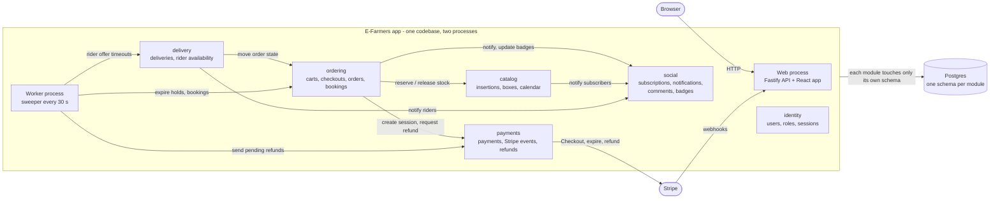
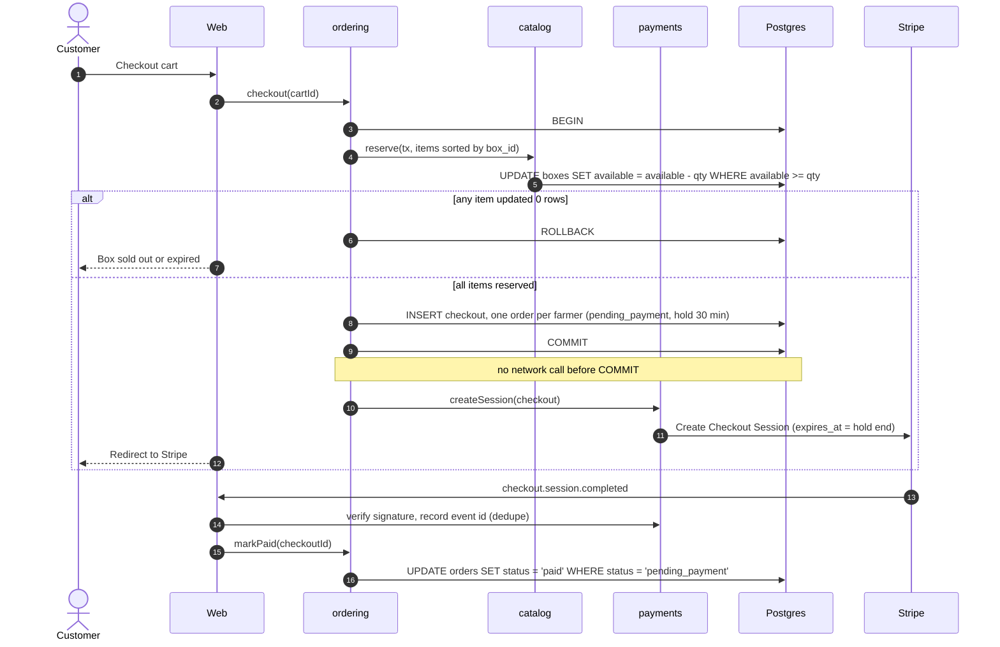

# ADR-001: E-Farmers is built as a TypeScript modular monolith on one Postgres

**Status:** Accepted
**Date:** 2026-10-28
**Deciders:** E-Farmers team (3 students)

## Summary

- **Modular monolith:** one TypeScript codebase run as two processes (web app and worker), one Postgres with one schema per module, started with `docker compose up`.
- **No double selling:** box stock is taken by one conditional `UPDATE` inside one transaction, both at cart checkout (held 30 minutes, the minimum life of a Stripe Checkout Session) and when a farmer accepts a booking (held 48 hours for payment).
- **One sweeper owns every timeout:** payment holds, rider offers, unanswered booking requests and pending refunds are all handled by one job in the worker.
- **Borders are enforced by CI, not by discipline:** AI agents write most of the code, so dependency-cruiser and per-module Postgres schemas make wrong imports and foreign table writes fail the build.
- **Rejected:** microservices (stock reservation becomes a saga, ops cost with no team-scale reason) and Supabase (core logic in plpgsql and two runtimes, harder to test and type).

## Context

E-Farmers is a marketplace where local farmers publish insertions with boxes, customers buy or book them, and riders deliver them. One account can be customer, farmer and rider at once. Requirements: [`Tasks/data/EFarmers.txt`](../../Tasks/data/EFarmers.txt) (36 user stories).

The difficulty is in the domain (limited stock, money, races between people), not in scale.

- **Box stock.** Several customers check out the same few boxes; boxes also expire. Selling the same box twice is the worst bug the system can have.
- **Payment timing.** Stripe confirms payment by webhook, possibly late, while our own hold on the stock runs out. The two must not both win.
- **Rider dispatch.** A delivery is offered to all available riders; two can accept at once, and sometimes nobody accepts.
- **Booking approval.** A booked box needs the farmer's yes before money is taken, and the farmer must not accept more bookings than there are boxes.

Constraints:

- 3 students; AI agents write most of the code.
- Runs locally with `docker compose up`; no hosting required.
- TypeScript strict; every request and webhook payload is validated at runtime.

## Decision

E-Farmers is one TypeScript application with strict internal modules, one Postgres database and one worker process for timed work.

- Six modules, each owning one Postgres schema: identity, catalog, ordering, payments, delivery, social.
- Modules talk through function calls on each other's public `index.ts`; writes that span modules share one transaction passed as `tx`.
- The web process serves the API and the built React app; the worker process runs the sweeper. Both are the same image.
- Stripe Checkout handles payment; Better Auth handles email and OAuth login.

The exact rules are in [Key Design Rules](#key-design-rules).

### Component diagram



Every arrow inside the app is a function call on a module's `index.ts`; this is the full allowed dependency graph (Rule 5). Left out: the web process calls every module, and every module may read user ids from identity.

### Checkout sequence



The sweeper races with step 16 when a hold runs out; Rule 3 decides which one wins.

## Options Considered

- **A. Modular monolith (chosen).** One app, one Postgres, strict modules, a worker built from the same code.
- **B. Microservices with a broker.** A service and database per area (catalog, ordering, payments, delivery, notifications) talking over RabbitMQ or Kafka; checkout becomes a saga of reserve, pay and compensating release across services.
- **C. Backend-as-a-service (Supabase).** Managed Postgres, auth, row level security and realtime; checkout is a Postgres function called by RPC, Stripe lives in Deno edge functions, timeouts run on pg_cron.

## Trade-off Analysis

|                             | A. Modular monolith                         | B. Microservices                           | C. Supabase                                 |
| --------------------------- | ------------------------------------------- | ------------------------------------------ | ------------------------------------------- |
| Deploy units                | web + worker, one image                     | 5+ services, broker, 5+ databases          | Supabase stack + edge functions             |
| Where data lives            | one Postgres, schema per module             | one database per service                   | one Postgres, public schema + RLS           |
| Checkout stock              | one conditional `UPDATE` in one transaction | saga with reserve and compensate messages  | same `UPDATE`, inside a plpgsql function    |
| Background work             | one sweeper loop in the worker              | consumers per service, retries per queue   | pg_cron calling SQL and edge functions      |
| Where logic lives           | TypeScript modules                          | TypeScript spread over services            | plpgsql, RLS policies and Deno functions    |
| Validation / types          | zod at the edge, Drizzle types inside       | zod per service + shared message contracts | generated DB types; plpgsql untyped for TS  |
| Debugging                   | one process, one stack trace                | distributed tracing needed                 | logs in three places                        |
| Testing                     | Vitest against real Postgres                | contract + integration tests per service   | pgTAP + Deno tests + Supabase local stack   |
| Time to first feature       | short                                       | long (infrastructure first)                | shortest for CRUD, longer for checkout      |
| Main risk                   | module borders erode                        | partial failures, lost messages            | silent RLS mistakes, logic AI writes poorly |
| Fits 3 students + AI agents | yes                                         | no                                         | partly                                      |

- **A vs B:** microservices pay off with many independent teams, very uneven load or separate release cycles. None applies, and B turns the one transaction that prevents double selling into a saga. Rejected.
- **A vs C:** C gives login and realtime for free, but the hardest logic would be written in plpgsql and RLS, where strict TypeScript and AI agents help least, and it runs on `supabase start` instead of our own compose file. Rejected.

## Key Design Rules

These follow from the decision and are part of it.

1. **Stock changes only through one conditional update.** `catalog.reserve(tx, items)` locks boxes in `box_id` order (fixed order, no deadlocks) and runs per item:
   ```sql
   UPDATE catalog.boxes
   SET available = available - :qty
   WHERE id = :id AND available >= :qty AND expires_at > now();
   ```
   0 rows means sold out or expired, and the whole transaction rolls back. `available` has `CHECK (available >= 0)`. Expired boxes need no job: every read and this update filter on `expires_at`.
   A future harvest is not a separate concept: a box has `available_from`, `quantity`, `available` and `expires_at`. Boxes with `available_from` in the future are shown in the calendar and can only be booked, not added to the cart. When a farmer accepts a booking, the same `reserve` runs; 0 rows means the accept fails and the booking stays `pending`.
2. **No network call inside a database transaction.** Stripe is called only after `COMMIT`. If creating the session fails, the stock is released and the orders move to `expired` at once, in one transaction. A transaction that waits on the network holds box locks and blocks every other checkout.
3. **Order state changes only through `ordering.transition(tx, orderId, from, to)`.** It runs `UPDATE ... SET status = :to WHERE id = :id AND status = :from` and fails on 0 rows. Allowed moves: `pending_payment -> paid | expired`, `paid -> completed`. Because both the webhook and the sweeper need `pending_payment`, only one of them can win.
   Cart checkout and booking accept both end the same way: stock reserved, a checkout with its orders in `pending_payment`, and a `hold_expires_at` (30 min from the cart, 48 h from a booking accept). From there payment, expiry and refund are one code path. Booking requests have their own states: `pending -> accepted | declined | expired`.
4. **Money goes back through a refund row, never a direct call.** `payments.requestRefund(tx, paymentId, amount)` inserts a `pending` refund in the caller's transaction; the sweeper sends it to Stripe with the refund id as idempotency key and retries until Stripe confirms. Cases: payment arrives for an expired checkout (full refund, no re-reservation), and no rider accepts (delivery fee refund).
5. **Module borders are enforced by the build.** Each module is `src/modules/<name>/`, and only its `index.ts` may be imported from outside. dependency-cruiser in CI fails on deep imports, cycles, and any edge not in the component diagram. Drizzle table objects live inside their module, so no other module can write those tables; each module's tables are in its own Postgres schema, so a CI grep for `<schema>.` in raw SQL outside that module catches the rest.
6. **All timeouts live in one sweeper.** The worker runs it every 30 s; each step uses conditional updates, so running it twice is harmless.
   - Payment hold (30 min after cart checkout, 48 h after booking accept): call Stripe `sessions.expire` on the open session first. If it succeeds or there is none, release stock and move orders to `expired` in one transaction. If Stripe says the session is already paid, move orders to `paid`. A Stripe session lives at least 30 min, so creating one sets `hold_expires_at` to at least the session's `expires_at`; a checkout has at most one open session.
   - Rider offer, 30 min: no rider accepted, so the order switches to pickup and the delivery fee is refunded (Rule 4).
   - Booking request, 72 h without a farmer answer: `expired`, customer notified.
   - Pending refunds: sent to Stripe (Rule 4).
7. **First accept wins for riders.** `UPDATE delivery.deliveries SET rider_id = :rider, status = 'assigned' WHERE id = :id AND status = 'offered'`; 0 rows means someone was faster.
8. **Every input is validated at the edge.** HTTP bodies, query strings and Stripe webhook payloads go through zod schemas before reaching a module; webhook signatures are verified and event ids are stored with a unique constraint, so a repeated event is ignored.

## Technology Stack

- **Node.js 22 + TypeScript strict** - one language for API, worker and UI; required by the team.
- **Fastify + zod type provider** - typed routes with runtime validation from the same schema.
- **React + Vite + TanStack Query** - plain SPA, served by the web process; no server rendering needed.
- **Drizzle ORM + drizzle-kit** - typed SQL close to raw queries, `pgSchema` per module, versioned migrations.
- **PostgreSQL 17** - transactions and conditional updates carry the hard flows; full text search covers story 8.
- **Better Auth** - email and OAuth login (stories 1, 29) with a Drizzle adapter, tables in the identity schema.
- **Stripe Checkout + Stripe CLI** - hosted payment page; the CLI container forwards webhooks locally.
- **Vitest** - integration tests against the compose Postgres, including a concurrency test: 20 parallel checkouts on 5 boxes, exactly 5 succeed.
- **ESLint (typescript-eslint strict) + Prettier + dependency-cruiser** - formatting, type-aware lint and module borders in CI.
- **`docker compose up`** - starts postgres, web, worker and stripe-cli.

## Consequences

**Easier**

- The hardest flow is one transaction, readable top to bottom and testable against a real database.
- One process to debug, one image to build, one database to back up.
- Notifications are rows written in the same transaction as the event, so they never get lost or sent for something that was rolled back.

**Harder**

- Module borders depend on CI rules being kept strict; a team that disables a rule loses them.
- The web process and the worker scale together; heavy work in one affects the other.
- Notifications are in-app only and seen on the next poll, not pushed live.

**Risks (where it bites first)**

1. An agent writes a stock or status change as read-then-write instead of a conditional update -> double selling under load. Mitigated by rules 1 and 3 and the concurrency test.
2. An agent calls Stripe inside a transaction -> checkouts block each other while Stripe is slow. Mitigated by rule 2.
3. Webhooks do not reach a developer's machine -> orders stay `pending_payment` and look broken. Mitigated by the stripe-cli service in compose and by the sweeper resolving every hold within 30 minutes (rule 6).

**To revisit**

- Payouts to farmers and riders (Stripe Connect): out of scope for v1, reopened when real money must reach them.
- Live push notifications (SSE): reopened if polling the notification center feels slow in use.
