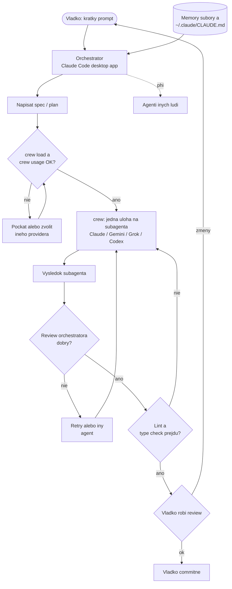

# Task 10 Bonus: moj workflow

Pouzivam Claude Code (desktop appku) ako orchestratora, proste ako sefa. Sam kod necita. Pise specy a plany a potom deleguje.

**Ako to funguje**
1. Poslem kratky prompt. Po kazdom kroku si pozriem vysledok.
2. Orchestrator napise spec alebo plan. Cita moj globalny `~/.claude/CLAUDE.md` a memory subory, v ktorych mam pravidla medzi sessionmi.
3. Predtym nez pusti agentov, spusti `crew load` (CPU a RAM) a `crew usage` (quota predplatneho).
4. Jednu ulohu da jednemu subagentovi cez `crew`. Provider a tier (Claude, Gemini, Grok, Codex) zavisi od ulohy.
5. Pozrie sa na vysledok. Ak je slaby, skusi znova alebo da ulohu inemu agentovi.
6. Lint a type check musia prejst.
7. Ja si prejdem pracu a commitnem si sam.

Na posielanie sprav agentom inych ludi pouzivam este `phi` (Pheidippides).

Oba tooly som si napisal sam:
- crew: https://github.com/Vl4dk0/crew
- Pheidippides (phi): https://github.com/Vl4dk0/pheidippides

**Validacne slucky:** review orchestratora (retry alebo iny agent), lint a type check a moj review pred kazdym commitom.

